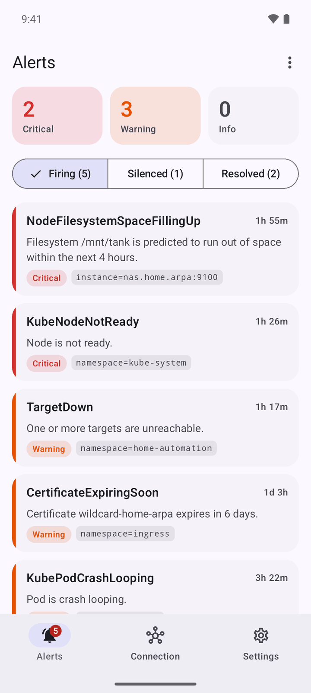
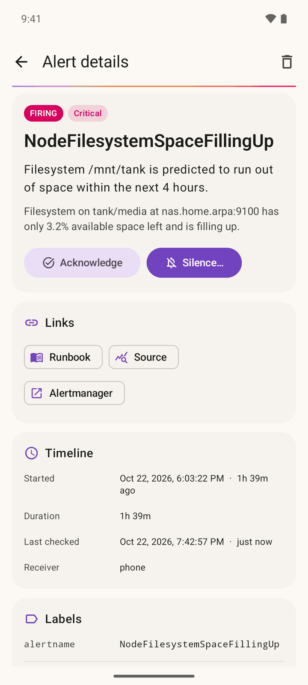
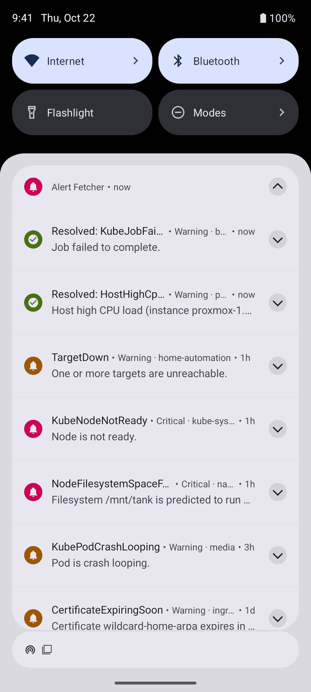
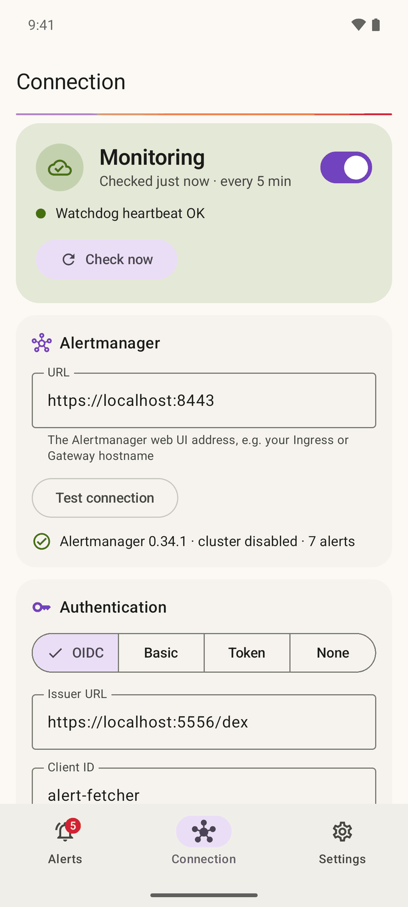
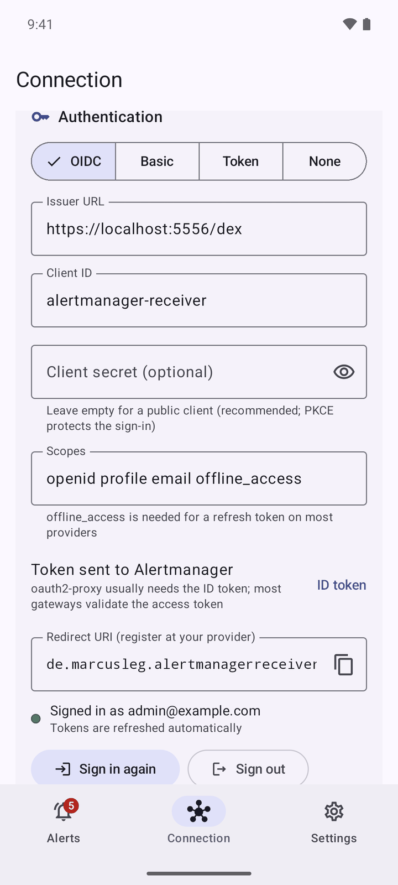
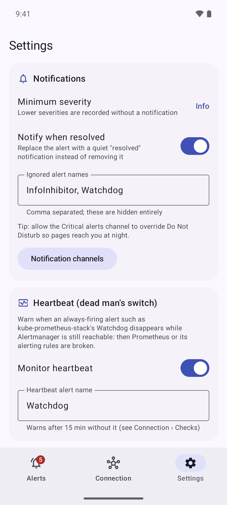
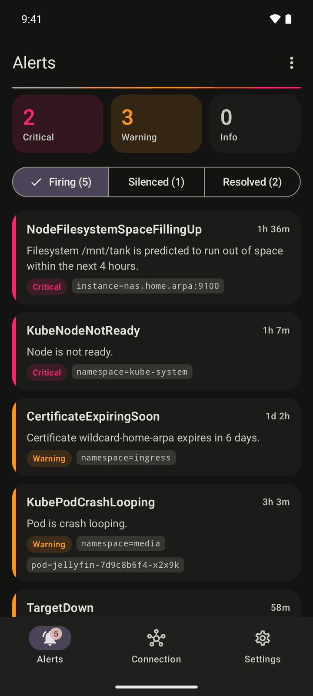
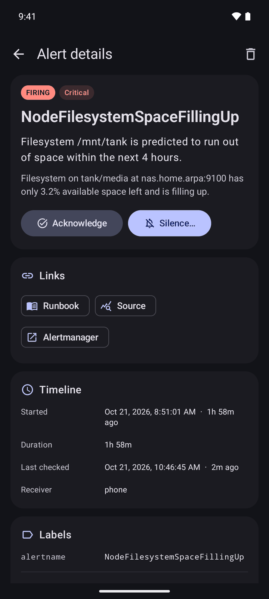

<div align="center">


# Alert Fetcher for Android

**Get Prometheus Alertmanager alerts on your phone, straight from your own Alertmanager.**

The app checks your Alertmanager's API over HTTPS and turns new alerts into Android notifications.
No Pushover, Telegram, ntfy, Firebase or any other third-party relay is involved, and nothing on the phone listens for incoming connections.

[](https://github.com/marcusleg/alert-fetcher-for-android/actions/workflows/build.yml)


</div>

<p align="center">
  
  
  
  
</p>

## Why?

Homelab Kubernetes clusters often send alerts through hosted services. That adds an account, an outside dependency, and a third party that sees your infrastructure's alerts.

Your Alertmanager already knows everything that is firing, and it is often already exposed through an Ingress or Gateway, protected by your single sign-on. This app simply asks it, the same way its web UI does:

```
┌────────────┐  alerts  ┌──────────────┐        ┌──────────────────────────┐   HTTPS, every 5 min   ┌──────────────────────────┐
│ Prometheus │ ───────▶ │ Alertmanager │ ◀───── │ Ingress / Gateway        │ ◀───────────────────── │ 📱 Alertmanager Receiver │
└────────────┘          └──────────────┘        │ + OIDC / basic auth proxy│   GET /api/v2/alerts   │  → notifications         │
                                                └──────────────────────────┘   POST /api/v2/silences│  → alert history         │
                                                                                                    │  → dead man's switch     │
                                                                                                    └──────────────────────────┘
```

Because the phone only makes outgoing HTTPS requests:

- **Nothing to expose on the phone**, and no port that other devices on a café Wi‑Fi could reach.
- **Works away from home**, wherever Alertmanager is reachable: through your VPN, or via the internet behind your SSO.
- **Proper TLS** with the certificate your Ingress already has (Let's Encrypt or a private CA).
- **No Alertmanager configuration per phone.** Changing IP addresses don't matter, and any number of phones can watch the same Alertmanager.

## Features

- **HTTPS only**: cleartext traffic is disabled app-wide; `http://` URLs are rejected.
- **Authentication**:
  - **OpenID Connect**: sign in with any standards-compliant provider such as Keycloak, Authentik, Authelia, Zitadel or Dex (authorization code flow with PKCE in a browser tab, so the app never sees your password). Tokens are refreshed in the background. Tested with Dex and oauth2-proxy.
  - **Basic auth** or a static **bearer token**.
  - **Additional request headers**, e.g. Cloudflare Access service tokens.
- **Configurable check interval**: 1 minute to 1 hour, 5 minutes by default. A foreground service and wake-up alarms keep checks running while the phone sleeps.
- **Notifications by severity**: separate channels for Critical, Warning, Info and Resolved. Each can have its own sound, vibration and Do Not Disturb override.
  - New alerts notify once; unchanged alerts stay quiet.
  - Resolved alerts replace the firing notification with a quiet "resolved" one, or remove it.
  - Alerts silenced or inhibited in Alertmanager don't notify, and notify again when the silence runs out.
  - Notification actions: **Acknowledge** and **Silence 1h**.
- **Knows when monitoring is broken**:
  - **Can't reach Alertmanager**: warns after a configurable time without a successful check (15 minutes by default). Being offline is not reported.
  - **Sign-in required**: warns immediately when credentials are rejected or the OIDC session expired.
  - **Heartbeat / dead man's switch**: warns when the always-firing `Watchdog` alert disappears while Alertmanager is reachable, which means Prometheus or its rules are broken.
- **Alert history**: firing, silenced and resolved alerts with labels, annotations, a timeline, and links to the runbook, dashboard, Prometheus query and Alertmanager.
- **Silences from your phone**: creates an Alertmanager silence (1 hour up to 1 week) that matches the alert's exact label set, signed with your OIDC username.
- **Choose what reaches the phone**: by Alertmanager receiver (route alerts to a receiver without integrations), minimum severity, and ignored alert names.
- **Setup help in the app**: connection test (version, cluster state, alert count), a log of recent checks, and copy-paste snippets for the route, `AlertmanagerConfig` and oauth2-proxy.
- **Private by design**: no analytics and no Google services. Credentials and alerts stay in the app's private storage and are excluded from cloud backups.

<p align="center">
  
  
  
  
</p>

## Requirements

- Android 8.0 (API 26) or newer.
- **Alertmanager's API reachable from the phone over HTTPS**, typically through the same Ingress or Gateway (and auth proxy) as its web UI. Through a VPN such as WireGuard or Tailscale is just as fine.
- A certificate the phone trusts. For a private CA, install the CA certificate on the phone: *Settings › Security › Encryption & credentials › Install a certificate › CA certificate*.

## Getting started

1. **Install** the APK from the [releases page](https://github.com/marcusleg/alert-fetcher-for-android/releases), or [build it yourself](#building).
2. **Open the app** and allow notifications.
3. On the **Connection** tab, enter the URL of Alertmanager, the same address you open its web UI with, e.g. `https://alertmanager.example.com`.
4. Choose how to **authenticate** (see below) and tap **Test connection**.
5. Turn on **monitoring**. The app checks right away and then every 5 minutes.
6. In **Settings › Reliability**, tap **Allow background use**, and optionally allow **alarms & reminders** so that checks run on time while the phone sleeps.

## Authentication

### OpenID Connect

1. Register a client for the app at your identity provider:
   - **Client type**: public, with PKCE (S256). A confidential client with a secret works too.
   - **Redirect URI**: `de.marcusleg.alertmanagerreceiver:/oauth2redirect` (shown in the app with a copy button).
   - **Scopes**: `openid profile email offline_access`. `offline_access` gets a refresh token, so you don't have to sign in again when the access token expires.
2. In the app, choose **OIDC**, enter the issuer URL and client ID, and tap **Sign in**. Your provider's login page opens in a browser tab.
3. Make the proxy in front of Alertmanager accept the app's tokens as `Authorization: Bearer` tokens. Choose in the app whether the **access token** or the **ID token** is sent: it depends on what your proxy validates (see below).

#### oauth2-proxy

oauth2-proxy accepts bearer tokens from additional clients with two flags:

```sh
--skip-jwt-bearer-tokens=true
--extra-jwt-issuers=https://sso.example.com/realms/homelab=alertmanager-receiver   # <issuer>=<app's client ID>
```

oauth2-proxy checks that the token's audience is the client ID given here. ID tokens always have that audience; access tokens only with some providers (e.g. Dex, or Keycloak with an audience mapper). If unsure, send the **ID token**.

With the kube-prometheus-stack and the oauth2-proxy Helm chart, add the flags to `extraArgs`:

```yaml
extraArgs:
  skip-jwt-bearer-tokens: true
  extra-jwt-issuers: https://sso.example.com/realms/homelab=alertmanager-receiver
```

This setup is part of the [local test environment](#try-it-locally) and is tested end to end.

#### Other proxies and gateways

Anything that validates a JWT bearer token from your provider works, for example Envoy Gateway's `SecurityPolicy` (`jwt` provider), Pomerium, or Traefik/NGINX with a forward-auth service that accepts bearer tokens. Point it at your provider's JWKS and allow the audience of the token you send. These setups are not part of the automated tests; reports and snippets are welcome.

### Basic auth

For an Ingress with basic auth (e.g. `nginx.ingress.kubernetes.io/auth-type: basic`), Traefik's `basicAuth` middleware, or Alertmanager's own [`--web.config.file`](https://prometheus.io/docs/alerting/latest/https/) with `basic_auth_users`.

### Bearer token

A static token sent as `Authorization: Bearer …`, e.g. for a proxy that validates Kubernetes service account tokens.

### Additional headers

Sent with every request, one `Name: value` per line. For example, a [Cloudflare Access service token](https://developers.cloudflare.com/cloudflare-one/identity/service-tokens/):

```
CF-Access-Client-Id: 1a2b3c….access
CF-Access-Client-Secret: …
```

### None

Only for an Alertmanager that is protected in another way, e.g. reachable exclusively through your VPN. Requests still use HTTPS.

## Choosing what reaches the phone

Without further setup, the app shows every alert in Alertmanager (except `InfoInhibitor` and `Watchdog`).
To decide on the Alertmanager side, route the alerts you want on the phone to a receiver **without any integrations** and set **Only receivers** in the app to its name.
Alertmanager then records the receiver for each alert, and the app shows only those:

```yaml
receivers:
  - name: phone   # no integrations; the app reads the alerts via the API

route:
  routes:
    # Put this first; continue: true keeps your other routes working.
    - receiver: phone
      matchers:
        - severity=~"critical|warning"
      continue: true
```

The same with prometheus-operator:

```yaml
apiVersion: monitoring.coreos.com/v1alpha1
kind: AlertmanagerConfig
metadata:
  name: phone
  namespace: monitoring
spec:
  route:
    receiver: phone
    matchers:
      - name: severity
        matchType: =~
        value: critical|warning
    continue: true
  receivers:
    - name: phone
```

> [!NOTE]
> prometheus-operator prefixes receiver names with the namespace and resource name, so filter on `monitoring/phone/phone`. It also adds a `namespace="monitoring"` matcher by default; to match alerts from all namespaces, set `alertmanagerConfigMatcherStrategy: {type: None}` on the Alertmanager resource.

## Checks, battery and reliability

- The **check interval** (1 minute to 1 hour, default 5 minutes) is the longest it takes for a new alert to reach you. Each check is a single small HTTPS request.
- A **foreground service** keeps the app running, and an **alarm** wakes the phone for each check. Without the *Alarms & reminders* permission, Android may delay checks by a few minutes while the phone sleeps.
- **Disable battery optimization** for the app. On some vendors (Xiaomi, Huawei, Samsung, OnePlus…) also check [dontkillmyapp.com](https://dontkillmyapp.com).
- When checks fail while the phone is online, the app warns after **Warn when unreachable for** (15 minutes by default, at least two missed checks). The **Recent checks** log on the Connection tab shows each check's result and error.
- After the network comes back, the app checks immediately instead of waiting for the next interval.

## Heartbeat (dead man's switch)

kube-prometheus-stack ships the always-firing `Watchdog` alert. If it disappears while Alertmanager still answers, Prometheus or its alerting rules are broken.

Enable **Settings › Heartbeat**. The app then warns when no `Watchdog` was seen for the *Warn when unreachable for* time, and tells you when it is back. The heartbeat alert itself is never shown as an alert. No routing is needed: the app sees the `Watchdog` alert even if it is routed to the `null` receiver.

## Silences

The **Silence…** button on an alert, and the **Silence 1h** notification action, call `POST /api/v2/silences` with the same URL and credentials as the checks.
The silence matches all of the alert's labels exactly and is created by your OIDC username (or basic auth user). The alert moves to the *Silenced* tab after the next check, which runs right away.

## Severity mapping

The `severity` label decides the notification channel:

| Label value | Channel |
|---|---|
| `critical`, `error`, `high`, `page`, `emergency`, `fatal`, `p1` | **Critical**: high priority, vibration |
| `warning`, `warn`, `medium`, `major`, `minor`, `p2`, `p3` and *unknown or missing* values | **Warning**: high priority |
| `info`, `none`, `low`, `notice`, `p4`, `p5` | **Info**: default priority |

Each channel can be customised in Android's notification settings. Tip: let **Critical** override Do Not Disturb.

## Security notes

- All connections use **HTTPS** with the system's certificate validation. Cleartext traffic is blocked for the whole app. CA certificates you installed yourself are trusted, so private CAs work.
- **Redirects are not followed.** An auth proxy that answers with a login redirect is reported as an authentication problem, so credentials are never sent to another host.
- With **OIDC**, you sign in on your provider's page in a browser tab (authorization code flow with PKCE, via [AppAuth](https://github.com/openid/AppAuth-Android)). The app stores only the tokens; with a public client there is no client secret on the phone.
- Credentials, tokens and alerts stay in the app's private storage and are excluded from Android cloud backups and device transfers. The app talks only to your Alertmanager and, with OIDC, your identity provider.
- Silences need write access to the Alertmanager API, so the credentials the app uses can create silences. Alertmanager has no read-only role; restrict access at the proxy if you need that.

## Try it locally

[`dev/up.sh`](dev/up.sh) starts a TLS-only test environment with Podman (or Docker via `CONTAINER_ENGINE=docker`):

| URL | What |
|---|---|
| `https://localhost:9443` | Alertmanager behind basic auth (`phone` / `phone`) |
| `https://localhost:8443` | Alertmanager behind oauth2-proxy, accepting OIDC bearer tokens |
| `https://localhost:5556/dex` | Dex identity provider (`admin@example.com` / `password`, client ID `alertmanager-receiver`) |

It creates a throwaway CA in `dev/.state/ca.crt`; install that on the phone or emulator as a CA certificate. With the emulator, forward the ports so `localhost` works on the device:

```sh
./dev/up.sh
adb reverse tcp:9443 tcp:9443 && adb reverse tcp:8443 tcp:8443 && adb reverse tcp:5556 tcp:5556
./scripts/send-demo-alerts.py                          # fire realistic homelab alerts (and a Watchdog)
./scripts/send-demo-alerts.py --resolve KubeJobFailed  # resolve some
./dev/down.sh
```

[`scripts/send-demo-alerts.py`](scripts/send-demo-alerts.py) needs only the Python standard library and also works against other Alertmanagers (`--url`, `--user`, `--password`, `--cacert`).

## Building

Requirements: JDK 17 or newer, and the Android SDK (platform 37). Set `sdk.dir` in `local.properties` or `ANDROID_HOME`.

```sh
./gradlew assembleDebug          # app/build/outputs/apk/debug/app-debug.apk
./gradlew testDebugUnitTest      # unit tests (API parsing, state changes, health checks, auth headers…)
./gradlew lintDebug
```

The debug build has the application ID `de.marcusleg.alertmanagerreceiver.debug`, so its OIDC redirect URI is `de.marcusleg.alertmanagerreceiver.debug:/oauth2redirect`.

Release builds are minified with R8. To sign them, create `keystore.properties` in the project root:

```properties
storeFile=release.jks
storePassword=…
keyAlias=…
keyPassword=…
```

…or set `SIGNING_STORE_FILE`, `SIGNING_STORE_PASSWORD`, `SIGNING_KEY_ALIAS` and `SIGNING_KEY_PASSWORD`, then run `./gradlew assembleRelease`.
The GitHub Actions workflow builds and tests every push. On `v*` tags it publishes a signed APK to GitHub Releases; this requires the signing secrets to be set in the repository.

### Project layout

```
app/src/main/java/de/marcusleg/alertmanagerreceiver/
├── model/          Alertmanager API v2 models (kotlinx.serialization), severity, fingerprints
├── alertmanager/   HTTPS API client, request authentication, silences
├── auth/           OpenID Connect sign-in and token refresh (AppAuth)
├── monitor/        Poller, check scheduling (AlarmManager), connection and heartbeat health
├── service/        Foreground service, boot receiver
├── data/           Room database (alerts, check log), DataStore settings
├── notify/         Notification channels, per-alert notifications, actions
├── util/           Config snippets, time formatting
└── ui/             Jetpack Compose + Material 3 screens
dev/                Local test environment (Alertmanager, Dex, oauth2-proxy, Caddy)
scripts/            Demo alert injector
```

Tech: Kotlin · Jetpack Compose · Material 3 · AppAuth · Room · DataStore · kotlinx.serialization · coroutines/Flow.
