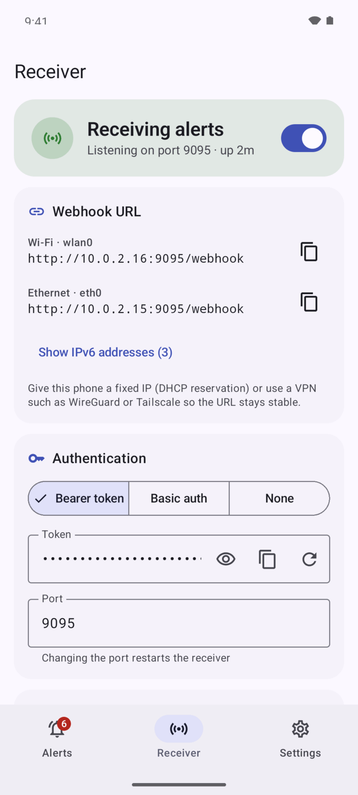
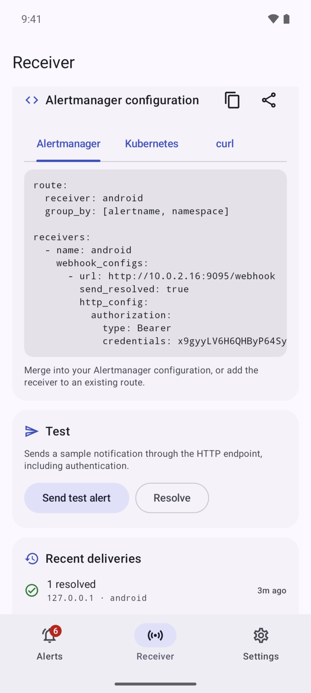

<div align="center">


# Alertmanager Receiver for Android

**Get Prometheus Alertmanager notifications on your phone, with no cloud involved.**

The app runs a small webhook server on your Android phone. Alertmanager posts alerts straight to it over your LAN or VPN.
No Pushover, Telegram, ntfy, Firebase or any other third-party relay is needed.

[](https://github.com/marcusleg/alertmanager-receiver-for-android/actions/workflows/build.yml)


</div>

<p align="center">
  
  
  
  
</p>

## Why?

Homelab Kubernetes clusters often send alerts through hosted services. That adds an account, an outside dependency, and a third party that sees your infrastructure's alerts.
For many homelabs the phone is already on the same network as the cluster, or on a WireGuard or Tailscale VPN. In that case Alertmanager can simply call the phone.

This app makes the phone a regular Alertmanager [`webhook_config`](https://prometheus.io/docs/alerting/latest/configuration/#webhook_config) receiver.

```
┌────────────┐   alerts    ┌──────────────┐   HTTP POST /webhook    ┌──────────────────────────┐
│ Prometheus │ ──────────▶ │ Alertmanager │ ──────────────────────▶ │ 📱 Alertmanager Receiver │
└────────────┘             └──────────────┘   LAN · WireGuard ·     │  → notification          │
                                   ▲          Tailscale             │  → alert history         │
                                   └────────── silences (API v2) ── │  → dead man's switch     │
                                                                    └──────────────────────────┘
```

## Features

- **Self-hosted webhook receiver**: an embedded HTTP server ([Ktor](https://ktor.io)) that runs as a foreground service and restarts after a reboot or app update.
- **Authentication**: a bearer token (generated on first launch) or HTTP basic auth, compared in constant time. "None" is available for trusted networks.
- **Notifications by severity**: separate channels for Critical, Warning, Info and Resolved. Each can have its own sound, vibration and Do Not Disturb override.
  - Repeat notifications from Alertmanager (`repeat_interval`) update the existing notification silently, and only alert again if you swiped it away.
  - Resolved alerts replace the firing notification with a quiet "resolved" one, or remove it.
  - Notification actions: **Acknowledge** and **Silence 1h**.
- **Alert history**: firing and resolved alerts with labels, annotations, a timeline, and links to the runbook, dashboard, Prometheus query and Alertmanager.
- **Silences from your phone**: creates an Alertmanager silence (1 hour up to 1 week) that matches the alert's exact label set.
- **Heartbeat / dead man's switch**: you get an alarm when the always-firing `Watchdog` alert stops arriving. That means Prometheus, Alertmanager or the network path to your phone is broken, which a receiver can't otherwise tell you.
- **Copy-paste configuration**: the app generates `alertmanager.yml`, a prometheus-operator `AlertmanagerConfig` (with a Secret), and a `curl` test command, pre-filled with your phone's IP and credentials.
- **Built-in test**: sends a sample alert through the real HTTP endpoint, including authentication.
- **Delivery log**: recent webhook calls with source IP and result, including rejected ones (401 / 400), to help debug the setup.
- **Filtering**: set a minimum severity to notify, and alert names to drop entirely (by default `InfoInhibitor` from kube-prometheus-stack).
- **Private by design**: no analytics and no Google services. Credentials and alerts are excluded from cloud backups.

<p align="center">
  
  
  
  
</p>

## Requirements

- Android 8.0 (API 26) or newer.
- **Alertmanager must be able to reach the phone.** Typical setups:
  - The phone is on the same LAN as the cluster. Give it a fixed IP with a DHCP reservation.
  - The phone is on a VPN: WireGuard, Tailscale, Headscale, Netbird or ZeroTier. This also works away from home, and the VPN encrypts the traffic.

## Getting started

1. **Install** the APK from the [releases page](https://github.com/marcusleg/alertmanager-receiver-for-android/releases), or [build it yourself](#building).
2. **Open the app** and allow notifications.
3. On the **Receiver** tab, turn the receiver on. The tab shows the webhook URL (for example `http://192.168.1.50:9095/webhook`) and the generated token.
4. **Configure Alertmanager** with one of the snippets below, or copy the pre-filled version from the app.
5. Tap **Send test alert**, or send a test from another machine with `curl` (the command is in the app).
6. In **Settings → Reliability**, tap **Allow background use** so Android doesn't stop the receiver while the screen is off.

### Plain `alertmanager.yml`

```yaml
route:
  receiver: android
  group_by: [alertname, namespace]

receivers:
  - name: android
    webhook_configs:
      - url: http://192.168.1.50:9095/webhook
        send_resolved: true
        http_config:
          authorization:
            type: Bearer
            credentials: <token from the app>
```

### kube-prometheus-stack (Helm values)

Store the token in a Secret and mount it into Alertmanager:

```sh
kubectl -n monitoring create secret generic android-receiver --from-literal=token='<token from the app>'
```

```yaml
alertmanager:
  alertmanagerSpec:
    secrets: [android-receiver]   # mounted at /etc/alertmanager/secrets/android-receiver/
  config:
    route:
      receiver: android
      group_by: [alertname, namespace]
      routes:
        # Heartbeat for the dead man's switch (see below). Must come before the
        # chart's default route that sends Watchdog to the "null" receiver.
        - receiver: android
          matchers: [alertname="Watchdog"]
          group_wait: 0s
          group_interval: 1m
          repeat_interval: 5m
        - receiver: "null"
          matchers: [alertname="InfoInhibitor"]
    receivers:
      - name: "null"
      - name: android
        webhook_configs:
          - url: http://192.168.1.50:9095/webhook
            send_resolved: true
            http_config:
              authorization:
                type: Bearer
                credentials_file: /etc/alertmanager/secrets/android-receiver/token
```

### prometheus-operator `AlertmanagerConfig`

```yaml
apiVersion: v1
kind: Secret
metadata:
  name: android-receiver
  namespace: monitoring
stringData:
  token: <token from the app>
---
apiVersion: monitoring.coreos.com/v1alpha1
kind: AlertmanagerConfig
metadata:
  name: android-receiver
  namespace: monitoring
spec:
  route:
    receiver: android
    groupBy: [alertname, namespace]
  receivers:
    - name: android
      webhookConfigs:
        - url: http://192.168.1.50:9095/webhook
          sendResolved: true
          httpConfig:
            authorization:
              type: Bearer
              credentials:
                name: android-receiver
                key: token
```

> [!NOTE]
> By default, prometheus-operator adds a `namespace="monitoring"` matcher to the routes of an `AlertmanagerConfig`. To receive alerts from all namespaces, set `alertmanagerConfigMatcherStrategy: {type: None}` on the Alertmanager resource, or reference the config with `alertmanagerConfiguration`.

### Several phones

Add one `webhook_configs` entry per phone. Each phone has its own URL and token.

## Heartbeat (dead man's switch)

A receiver can't notice when nothing arrives, so a broken Alertmanager or a changed phone IP would go unnoticed. kube-prometheus-stack ships the always-firing `Watchdog` alert for this case.

1. Enable **Settings → Heartbeat** and choose a timeout, for example 15 minutes.
2. Route `Watchdog` to the phone with a `repeat_interval` well below the timeout. The configuration generated by the app includes this route.

Heartbeat alerts are not shown as alerts. The Receiver tab shows when the last one arrived.
If none arrives within the timeout, you get a high-priority notification. When the heartbeat comes back, a "restored" notification follows.

## Silences

The **Silence…** button on an alert, and the **Silence 1h** notification action, call `POST /api/v2/silences` on Alertmanager.
The silence matches all of the alert's labels exactly. The app uses the `externalURL` from the webhook payload.
If that URL isn't reachable from the phone (for example `http://alertmanager-operated:9093`), set **Settings → Alertmanager API → Alertmanager URL**. You can also set an `Authorization` header there, if your Alertmanager is behind an authenticating proxy.

## Severity mapping

The `severity` label decides the notification channel:

| Label value | Channel |
|---|---|
| `critical`, `error`, `high`, `page`, `emergency`, `fatal`, `p1` | **Critical**: high priority, vibration |
| `warning`, `warn`, `medium`, `major`, `minor`, `p2`, `p3` and *unknown or missing* values | **Warning**: high priority |
| `info`, `none`, `low`, `notice`, `p4`, `p5` | **Info**: default priority |

Each channel can be customised in Android's notification settings. Tip: let **Critical** override Do Not Disturb.

## HTTP endpoints

| Method & path | Auth | Purpose |
|---|---|---|
| `POST /webhook` | yes | Alertmanager webhook (payload version 4) |
| `POST /` | yes | Same as above, for convenience |
| `GET /healthz` | no | Liveness check, returns `ok` |

Responses: `200` accepted · `401` bad credentials · `400` invalid JSON · `413` body over 4 MiB · `500` processing failed. Alertmanager retries on 5xx responses.

## Reliability tips

- **Disable battery optimisation** for the app. On some vendors (Xiaomi, Huawei, Samsung, OnePlus…) also check [dontkillmyapp.com](https://dontkillmyapp.com).
- Use a **fixed IP**, or a VPN address that doesn't change.
- Turn on **Keep CPU awake** only if your device drops inbound connections in deep sleep. It holds a wake lock and uses more battery.
- If the phone is unreachable, Alertmanager retries the delivery, and firing alerts are re-sent every `repeat_interval`. Use the heartbeat to know when the phone hasn't heard from Alertmanager for a while.

## Security notes

- The receiver uses **plain HTTP**. Expose it only on a trusted LAN or over a VPN, which also encrypts the traffic. Never port-forward it to the internet.
- Bearer token auth is on by default, with a random 192-bit token. Rotate it at any time on the Receiver tab. Changes apply immediately, without a restart.
- Stored alerts and credentials stay in the app's private storage and are excluded from Android cloud backups and device transfers.

## Try it without a cluster

[`scripts/send-demo-alerts.py`](scripts/send-demo-alerts.py) sends realistic homelab alerts using only the Python standard library:

```sh
./scripts/send-demo-alerts.py http://192.168.1.50:9095/webhook --token <token>
./scripts/send-demo-alerts.py http://192.168.1.50:9095/webhook --token <token> --resolve-all
```

With the Android emulator, forward the port first with `adb forward tcp:9095 tcp:9095` and use `http://127.0.0.1:9095/webhook`.

## Building

Requirements: JDK 17 or newer, and the Android SDK (platform 37). Set `sdk.dir` in `local.properties` or `ANDROID_HOME`.

```sh
./gradlew assembleDebug          # app/build/outputs/apk/debug/app-debug.apk
./gradlew testDebugUnitTest      # unit tests (payload parsing, auth, HTTP routes, config snippets…)
./gradlew lintDebug
```

Release builds are minified with R8. To sign them, create `keystore.properties` in the project root:

```properties
storeFile=release.jks
storePassword=…
keyAlias=…
keyPassword=…
```

…or set `SIGNING_STORE_FILE`, `SIGNING_STORE_PASSWORD`, `SIGNING_KEY_ALIAS` and `SIGNING_KEY_PASSWORD`, then run `./gradlew assembleRelease`.
The GitHub Actions workflow builds and tests every push. On `v*` tags it publishes a signed APK to GitHub Releases; this requires the signing secrets to be set in the repository.

### Project layout

```
app/src/main/java/de/marcusleg/alertmanagerreceiver/
├── model/          Webhook payload (kotlinx.serialization), severity, fingerprints
├── server/         Ktor routes, authentication, embedded server lifecycle
├── service/        Foreground service, boot receiver, ingest pipeline
├── data/           Room database (alerts, delivery log), DataStore settings
├── notify/         Notification channels, per-alert notifications, actions
├── heartbeat/      Dead man's switch (AlarmManager)
├── alertmanager/   Alertmanager API v2 client (silences)
├── util/           Config snippet generator, network addresses, test sender
└── ui/             Jetpack Compose + Material 3 screens
```

Tech: Kotlin · Jetpack Compose · Material 3 · Ktor server (CIO) · Room · DataStore · kotlinx.serialization · coroutines/Flow.
